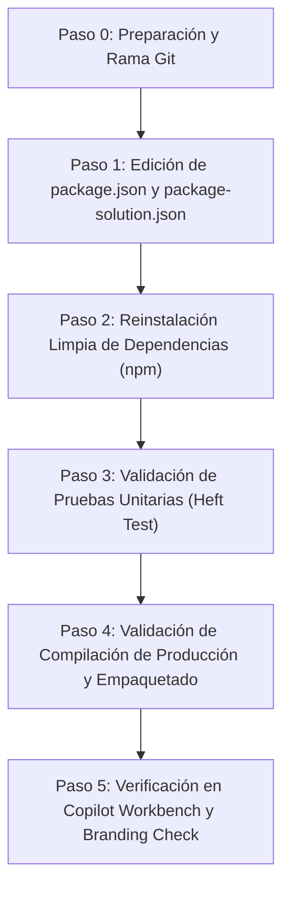

# Plan de Migración: SPFx 1.24.0-rc.0 a SPFx 1.24.0 GA (Copilot UX Components)

> **Contexto:** El 28 de octubre de 2026, Microsoft (Vesa Juvonen, Principal Program Manager) anunció la **Disponibilidad General (GA)** de **Copilot UX components** como parte oficial de **SharePoint Framework (SPFx) 1.24**. Este documento establece el plan paso a paso para actualizar `m365-live-survey-predemo` (`apps/satisfaction-survey`) desde la versión Release Candidate (`1.24.0-rc.0`) a la versión oficial de producción (`1.24.0` GA).

---

## 1. Resumen Ejecutivo y Hallazgos de GA

### Novedades clave de SPFx 1.24 GA (Artículo Oficial)
1. **Copilot UX components Listos para Producción:**
   - Modo de visualización predeterminado predecible en el canvas de Copilot.
   - Actualización automática de versiones en el manifiesto de Teams (eliminación de conflictos de versión al actualizar componentes).
   - Validación en tiempo de compilación (*build-time*) del manifiesto del agente declarativo (`declarativeAgent.json`).
   - Andamiaje y soporte completo para manifiestos de agente declarativo **v1.8**.
2. **Plataforma y Tooling:**
   - Soporte nativo para **React 18.x** out-of-the-box.
   - Compatibilidad oficial con **Node.js 24 y Node.js 26** LTS.
   - Correcciones de seguridad y mitigación de auditorías npm basadas en el feedback del preview.
3. **Requisito de Licencia Confirmado:**
   - La documentación oficial de GA confirma el comportamiento observado durante el Sprint 4: **Se requiere licencia de Microsoft 365 Copilot** para renderizar componentes en Copilot real (de lo contrario se muestra mensaje de requisito de licencia). El **Copilot Workbench** (`_layouts/15/copilotworkbench.aspx`) se mantiene como la herramienta oficial y soportada de depuración y prueba sin requerir dicha licencia.

---

## 2. Inventario de Cambios en la Solución (`apps/satisfaction-survey`)

La solución actual utiliza el rig moderno de compilación basado en `@rushstack/heft` introducido en SPFx 1.24.

### A. Dependencias de Producción (`dependencies` en `package.json`)
| Paquete | Versión Actual (RC) | Versión Objetivo (GA) | Acción |
|---|---|---|---|
| `@microsoft/sp-copilot-component` | `1.24.0-rc.0` | `1.24.0` | Actualizar a versión GA |
| `@microsoft/sp-lodash-subset` | `1.24.0-rc.0` | `1.24.0` | Actualizar a versión GA |
| `@microsoft/sp-http` | `1.24.0-rc.0` | `1.24.0` | Actualizar a versión GA |
| `react` / `react-dom` | `18.3.1` | `18.3.1` | Mantener (alineado con GA) |
| `@fluentui/react-components` | `^9.70.0` | `^9.70.0` | Mantener |
| `zod` / `zod-to-json-schema` | `3.24.1` | `3.24.1` | Mantener |

### B. Dependencias de Desarrollo (`devDependencies` en `package.json`)
| Paquete | Versión Actual (RC) | Versión Objetivo (GA) | Acción |
|---|---|---|---|
| `@microsoft/eslint-plugin-spfx` | `1.24.0-rc.0` | `1.24.0` | Actualizar a versión GA |
| `@microsoft/eslint-config-spfx` | `1.24.0-rc.0` | `1.24.0` | Actualizar a versión GA |
| `@microsoft/spfx-web-build-rig` | `1.24.0-rc.0` | `1.24.0` | Actualizar a versión GA |
| `@microsoft/spfx-heft-plugins` | `1.24.0-rc.0` | `1.24.0` | Actualizar a versión GA |
| `@rushstack/heft` | `1.3.2` | `1.3.2` (o la resuelta por rig) | Verificar compatibilidad |

### C. Manifiestos y Configuración
- `config/package-solution.json`: Cambiar `"mpnId": "Undefined-1.24.0-rc.0"` por `"Undefined-1.24.0"`.
- `copilot/declarativeAgent.json`: Ya se encuentra en schema `v1.8`. La compilación de GA validará el esquema de forma estricta.
- `src/copilotComponents/*/manifest.json`: Validar que `capabilities.availableDisplayModes` se mantenga válido (`inline` para encuesta; `inline` y `fullscreen` para scorecard).

---

## 3. Procedimiento de Ejecución Paso a Paso



### Paso 0: Preparación y Rama de Trabajo
Crear una rama específica para aislar la migración:
```bash
git checkout -b chore/upgrade-spfx-1.24-ga
```

### Paso 1: Actualizar Archivos de Configuración

1. En `apps/satisfaction-survey/package.json`, reemplazar todas las apariciones de `1.24.0-rc.0` por `1.24.0`:
   - `@microsoft/sp-copilot-component`: `"1.24.0"`
   - `@microsoft/sp-lodash-subset`: `"1.24.0"`
   - `@microsoft/sp-http`: `"1.24.0"`
   - `@microsoft/eslint-plugin-spfx`: `"1.24.0"`
   - `@microsoft/eslint-config-spfx`: `"1.24.0"`
   - `@microsoft/spfx-web-build-rig`: `"1.24.0"`
   - `@microsoft/spfx-heft-plugins`: `"1.24.0"`

2. En `apps/satisfaction-survey/config/package-solution.json`:
   - Actualizar `"mpnId"` a `"Undefined-1.24.0"`.

### Paso 2: Reinstalación Limpia de Dependencias
Para evitar conflictos de resolución en `node_modules` y bloqueos de cache en Heft:
```powershell
cd apps/satisfaction-survey
# Limpieza de cache y módulos existentes
Remove-Item -Recurse -Force node_modules, package-lock.json -ErrorAction SilentlyContinue
npm cache clean --force
npm install
```

### Paso 3: Ejecución de Pruebas Unitarias
Ejecutar la suite de pruebas unitarias Jest sobre `lib-commonjs`:
```powershell
npx heft test --clean
```
*Criterio de éxito: Las 73 pruebas existentes deben pasar en verde sin errores ni advertencias de ESLint.*

### Paso 4: Compilación y Empaquetado de Solución (.sppkg)
Ejecutar el pipeline de producción de Heft:
```powershell
npm run build
```
Este comando ejecuta:
- `heft test --clean --production` (con validación de tipos TS y reglas estrictas de ESLint).
- `heft package-solution --production` (empaquetado del archivo `solution/satisfaction-survey.sppkg`).
- Validación en tiempo de compilación del agente declarativo (`declarativeAgent.json`) y sincronización automática del manifiesto de Teams.

### Paso 5: Verificaciones de Calidad y Demo
1. **Verificación de Reglas de Marca:**
   ```powershell
   npm run check-branding
   ```
2. **Prueba local en Copilot Workbench:**
   ```powershell
   npm run start
   ```
   Abrir la URL del Workbench en el navegador:
   `https://<tenant>.sharepoint.com/_layouts/15/copilotworkbench.aspx`
   - Probar intención I1: `OpenSatisfactionSurvey` (formulario inline de satisfacción).
   - Probar intención I2: `ShowTechnicianScorecard` (scorecard inline y modo pantalla completa).
   - Validar temas visuales claro y oscuro (`vizPalette.ts`).

---

## 4. Matriz de Riesgos y Plan de Mitigación

| Riesgo / Punto Crítico | Impacto | Estrategia de Mitigación |
|---|---|---|
| **Colisión en `lib-commonjs` con `npm run start`** | Error `ENOENT` durante el build | Regla del autor #3: Asegurarse de detener el proceso de `start` antes de ejecutar `heft test` o `build`. |
| **Cambios en validación de schema de `declarativeAgent.json`** | El build falla en el plugin de Heft | Validar que `ai-plugin.json` y `instruction.txt` mantengan rutas relativas idénticas y schema `v1.8`. |
| **Advertencias de ESLint promovidas a error** | Fallo en build de producción | Mantener tipos de retorno explícitos y `.catch(() => undefined)` en promesas según restricciones técnicas §3 de HANDOFF. |
| **Mensaje de licencia en Copilot real** | Bloqueo en presentación en vivo | Plan B ya contemplado en Sprint 4: Uso del Copilot Workbench oficial como entorno de demostración en vivo (compatible sin licencia add-on). |

---

## 5. Criterios de Aceptación (Definition of Done)

- [x] Todas las referencias a `1.24.0-rc.0` eliminadas de `package.json` y `package-solution.json`.
- [x] `npm install` completa sin errores de árbol de dependencias.
- [x] `npx heft test --clean` pasa al 100% (73/73 tests).
- [ ] `npm run build` genera `satisfaction-survey.sppkg` sin advertencias (a ejecutar por el autor según Regla #3).
- [ ] `npm run check-branding` pasa satisfactoriamente (respetando la decisión actual sobre sample psd1).
- [ ] Los 2 componentes se cargan e interactúan correctamente en Copilot Workbench.
- [x] Documentación (`HANDOFF.md`, `README.md`) actualizada reflejando SPFx 1.24 GA.

