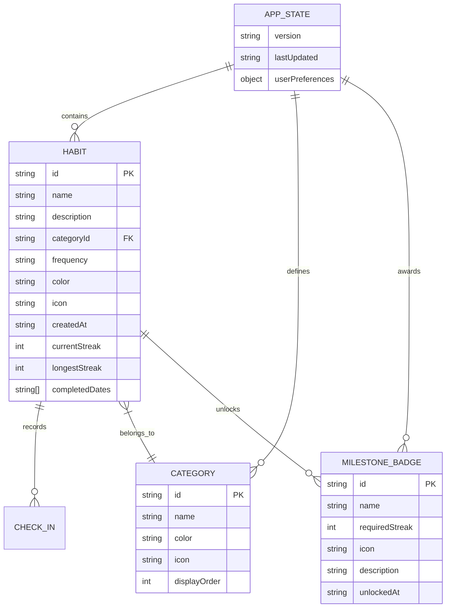

# Data Model — Level Up Habit Tracker

## 1. Diagrama Entidad-Relación y Estructura Lógica



## 2. Definiciones de Tipos TypeScript

```typescript
export type FrequencyType = 'daily' | 'weekdays' | 'weekends';

export type HabitCategory = 
  | 'study'
  | 'productivity'
  | 'fitness'
  | 'health'
  | 'content_creation'
  | 'mindset';

export interface CategoryDefinition {
  id: HabitCategory;
  label: string;
  color: string;
  gradient: string;
  iconSvg: string;
}

export interface Habit {
  id: string;
  name: string;
  description?: string;
  category: HabitCategory;
  frequency: FrequencyType;
  color: string;
  icon: string;
  createdAt: string; // ISO 8601 UTC
  completedDates: string[]; // Formato YYYY-MM-DD
  currentStreak: number;
  longestStreak: number;
}

export interface MilestoneBadge {
  id: string;
  name: string;
  thresholdDays: number;
  icon: string;
  description: string;
  color: string;
  unlockedAt: string | null;
}

export interface DayProgress {
  date: string; // YYYY-MM-DD
  dayLabel: string; // 'Lun', 'Mar', etc.
  completed: number;
  total: number;
  rate: number; // 0.0 a 1.0
}

export interface DashboardMetrics {
  totalHabits: number;
  completedTodayCount: number;
  completionRatePercent: number;
  activeStreaksCount: number;
  maxStreakRecord: number;
  motivationalMessage: string;
  weeklyProgress: DayProgress[];
}

export interface AppStoragePayload {
  version: number;
  lastUpdated: string;
  habits: Habit[];
  unlockedBadges: string[];
}
```

## 3. Catálogo de Datos Semilla (Seed Data)

Cuando `localStorage` está vacío, se siembran hábitos con estados de racha variados para mostrar la aplicación viva:

```json
[
  {
    "id": "seed-habit-1",
    "name": "Aprender algo nuevo de código",
    "description": "Dedicar 30 min a practicar TypeScript o nuevas APIs",
    "category": "study",
    "frequency": "daily",
    "color": "#4facfe",
    "icon": "code",
    "createdAt": "2026-10-25T08:00:00.000Z",
    "completedDates": ["2026-11-01", "2026-11-02", "2026-11-03", "2026-11-04"],
    "currentStreak": 4,
    "longestStreak": 10
  },
  {
    "id": "seed-habit-2",
    "name": "Entrenamiento de fuerza o cardio",
    "description": "Rutina de 45 min o caminata rápida",
    "category": "fitness",
    "frequency": "daily",
    "color": "#ff4e50",
    "icon": "flame",
    "createdAt": "2026-10-28T09:00:00.000Z",
    "completedDates": ["2026-11-03", "2026-11-04"],
    "currentStreak": 2,
    "longestStreak": 5
  },
  {
    "id": "seed-habit-3",
    "name": "Tomar 2.5L de agua",
    "description": "Mantener hidratación constante con termo",
    "category": "health",
    "frequency": "daily",
    "color": "#10b981",
    "icon": "droplet",
    "createdAt": "2026-10-20T07:00:00.000Z",
    "completedDates": ["2026-10-30", "2026-10-31", "2026-11-01", "2026-11-02", "2026-11-03", "2026-11-04"],
    "currentStreak": 6,
    "longestStreak": 12
  },
  {
    "id": "seed-habit-4",
    "name": "Borrador de publicación / video",
    "description": "Escribir un guion o post para redes",
    "category": "content_creation",
    "frequency": "weekdays",
    "color": "#e100ff",
    "icon": "sparkles",
    "createdAt": "2026-10-29T10:00:00.000Z",
    "completedDates": ["2026-11-04"],
    "currentStreak": 1,
    "longestStreak": 3
  },
  {
    "id": "seed-habit-5",
    "name": "Meditación y respiración 10 min",
    "description": "Desconexión de pantallas antes de dormir",
    "category": "mindset",
    "frequency": "daily",
    "color": "#00f2fe",
    "icon": "moon",
    "createdAt": "2026-10-22T21:00:00.000Z",
    "completedDates": [],
    "currentStreak": 0,
    "longestStreak": 7
  }
]
```

## 4. Validaciones y Reglas de Negocio

1. **Unicidad de fechas:** Un hábito no puede tener la misma fecha duplicada en `completedDates`.
2. **Fecha de Check-in:** La UI permite marcar y desmarcar el día de hoy (y opcionalmente inspeccionar días previos en modo lectura).
3. **Persistencia Transaccional:** Cada operación de mutación (crear, actualizar, borrar, toggle) recalcula las rachas y actualiza `localStorage` de forma sincrónica para evitar condiciones de carrera.
